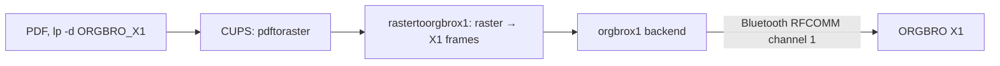

# CUPS driver for the ORGBRO X1

The ORGBRO X1 is a small Bluetooth label printer for 15 mm continuous tape (head 12 mm, 96 dots,
203 dpi). There is no driver for Linux; this one makes it an ordinary CUPS queue
(built for the label printing of [wp-taxonomy-modeler](https://github.com/sfambach/wp-taxonomy-modeler)). Python 3, standard library only.

| File | What it is |
|---|---|
| `rastertoorgbrox1` | CUPS filter: 1-bit raster in, X1 frames out |
| `orgbrox1` | CUPS backend: `orgbrox1://<address without colons>[/<channel>]`, e.g. `orgbrox1://0602ACC8AF65`, opens RFCOMM itself |
| `orgbro-x1.ppd` | sizes named by their millimetres, `w12h30` … `w12h100` and lying `w37h12` …, plus custom sizes; darkness 5 / 9 / 13 |
| `install.sh` | copies the three into CUPS and creates the queue |

## Protocol

Read from the vendor's app XeasyLabel, whose SDK calls the X1 «HP2». Every frame is
`64 cmd seq lenLo lenHi data… crc(4) 9B`; the app sends the checksum as zero and the printer takes it.

| cmd | data | meaning |
|---|---|---|
| `0A` | 1 byte | speed, the app sends 25 |
| `09` | 1 byte | darkness 5 / 9 / 13 |
| `04` | `18 00` | start of the job (first label only) |
| `00` | 24 × 12 bytes | 24 rows of 96 dots, MSB first, 1 = black; the app moves the picture one dot along |
| `02` | `48 00` / `18 00` | feed 72 dots after each label, 24 more after the last (the app); option `X1EndFeed=4…12` (mm) feeds less after the last one |

The printer answers with frames of command `FF` (status). The filter's output for a test picture is
byte for byte what the app sent, and that job printed.

A page wider than the head (96 dots) and at most 12 mm tall is a label lying along the tape: the filter turns it a
quarter, clockwise, so `w37h12` prints a 37 mm label with the text reading along the tape.

## Set up (Linux Mint)

1. Pair the X1 once (Bluetooth settings). Close its serial connection in the desktop afterwards,
   or that connection holds the channel.
2. `sudo ./install.sh 06:02:AC:C8:AF:65` — the address from `bluetoothctl devices`. Re-run it after
   an update; it overwrites the installed files and keeps the queue.
3. Test: `lp -d ORGBRO_X1 -o PageSize=w12h30 file.pdf` (12×30 mm). Other sizes:
   `lpoptions -p ORGBRO_X1 -l`.
4. Taxmod: the printer gets the queue `ORGBRO_X1` in the model; the print service then sends to it
   like to any other queue.

## Test

`python3 -m unittest discover orgbro-x1`

Trademarks: ORGBRO is a trademark of its owner; this driver is not affiliated with the maker.

## Retries

CUPS resends a whole job when a backend asks for a retry. The backend therefore retries only when the X1 could not be
reached or the connection broke before any data went out. If it breaks off after data reached the printer, the job
fails instead (a label may be missing, print it again); a reset while listening for the printer's replies counts as done.
